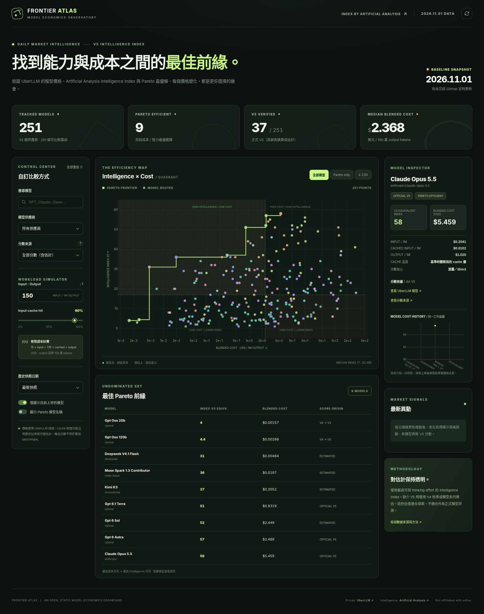

# Frontier Atlas — UberLLM 模型能力 × 成本每日追蹤



**完全靜態的 GitHub Pages 儀表板**，包含所有 251 個 UberLLM 模型／路由的起始資料、四象限、Pareto Frontier、模型詳細資訊、每日價格歷史、成本模擬器、供應商與分數來源篩選、CSV 匯出。每日更新使用 GitHub Actions 和 Python 標準函式庫，無資料庫、無付費伺服器、無前端 API key。

> [!IMPORTANT]
> **AA 授權：** Artificial Analysis 官方 Free API **僅供內部使用、須標註來源、不含公開再散布權**。本專案的基準資料及估值部分依據 AA，**公開部署含 Intelligence Index 分數的網站前，請先向 AA 取得對應的資料展示／再散布許可**，或改用具備公開使用權的指標。僅在網站註明 AA 來源並不能取代授權。見 https://artificialanalysis.ai/data-api 。
> 
> 程式在 GitHub 公開站模式下預設**不抓取新增 AA 分數**，即使設了 `AA_API_KEY` 也會被授權開關阻擋；但這項開關**不會自動清除或授權既有 251 筆起始分數**。請在公開發布前自行確認權利。

## 1. 一次性部署到 GitHub Pages（公開 repo 免費）

1. 登入 GitHub，點選 **New repository**，建立一個 **Public** repository，名稱建議 `uberllm-frontier`。建立時可選 **不要預先新增 README**，以免 push 衝突。
2. 解壓完整 ZIP，在含 `index.html` 的資料夾執行（將 `YOUR_GITHUB_USERNAME` 替換為自己的帳號）：

   ```bash
   git init
   git branch -M main
   git add .
   git commit -m "Launch Frontier Atlas"
   git remote add origin https://github.com/YOUR_GITHUB_USERNAME/uberllm-frontier.git
   git push -u origin main
   ```

3. 打開 GitHub repo → **Settings → Pages → Build and deployment → Source: `GitHub Actions`** 並儲存（**不要選 Deploy from a branch**；GitHub Actions 自動提交資料不會觸發 branch-based Pages 重建）。網站預期位置：`https://YOUR_GITHUB_USERNAME.github.io/uberllm-frontier/`。
4. Repo → **Actions → Daily UberLLM tracking + GitHub Pages publish → Run workflow**，先手動跑一次，查看 `refresh-data` 的 `parsed` 模型數量與 `price_unit_multiplier`，以及 `deploy-pages` 的部署結果。之後每天 **02:17 UTC／11:17 日本時間** 自動執行。若來源 API 格式變動或網路故障，動作會失敗但**不覆蓋前一天有效的資料**。

**選用 GitHub CLI 快速部署：** 若已安裝 [GitHub CLI](https://cli.github.com/)、執行 `gh auth login`、並確認 AA 分數公開權利，則不需先手動建立 repository，直接在專案根目錄執行：

```bash
bash scripts/deploy_github_pages.sh
```

腳本會要求你先確認分數的公開發布權利，再建立 **public** repo、提交完整程式、嘗試設定 Pages（GitHub Actions 模式），並啟動首次更新與發布。若 Pages API 啟用失敗，仍可到 Settings → Pages 手動選擇 `Source: GitHub Actions`。這是發生外部 GitHub 更動的操作，請在執行前讀取腳本並確認公開授權。你也可以用 GitHub Desktop 提交整個解壓資料夾。

## 2. 工作方式

```
                  +------------------------------+
                  | GitHub Actions daily @ 02:17 |
                  +--------------+---------------+
                                 |
                  +--------------v---------------+
                  | UberLLM public models API     |
                  | (no key; listed-price feed)   |
                  +--------------+---------------+
                                 |
          +----------------------v----------------------+
          | scripts/update.py                            |
          | - schema and token price scale validation    |
          | - cache price fallback                       |
          | - new models -> heuristic score              |
          | - optional AA V5 sync IF publication rights  |
          | - 365-day history + change notifications     |
          +----------------------+----------------------+
                                 |
                      commit data/*.json
                                 |
                 same workflow deploy-pages
                                 |
          +----------------------v----------------------+
          | GitHub Pages static HTML/CSS/JS + Plotly     |
          | four quadrants / filters / daily history    |
          +---------------------------------------------+
```

資料來源：

- UberLLM：模型清單使用 `https://api.uberllm.dev/api/v1/public/models`；所有價格改用官方頁面同源 `https://uberllm.dev/api/v1/public/market/live` 的 `price_now`（市場最低價，每百萬 tokens），包含 cache-read 價格。每日快照保留來源時間，並非每 30 秒更新；實際成交價可能較高。來源失敗時拒絕更新，不以列示價替代。2026-11-02 修正前的歷史資料仍為原目錄價格，跨此日期的變化可能包含價格來源切換。
- Artificial Analysis：`https://artificialanalysis.ai/api/v2/language/models/free`，API key 在伺服器／GitHub Actions secret 中，前端不會取得。**僅在取得合適的公開再散布許可時才能將官方 API 分數定期發布到公開 Pages**。官方說明：https://artificialanalysis.ai/data-api/docs 。
- 起始模型及分數：2026-11-01 的前次 251 個模型快照，涵蓋正式 V5、V4 校準與啟發式推估。**此快照不是即時 API 讀值**。未透過公開 API 實際驗證前，網站標記為 `BASELINE SNAPSHOT`。

## 3. 成本公式

資料記為每 100 萬 tokens 的美元價格。若 `R` 是 Input:Output 比例、`H` 是 input cache 命中比率，則每產生 100 萬 output tokens 的模型成本為：

```text
cost = R × (1 - H) × price_input
     + R × H × price_cached_input
     + price_output
```

預設 `R=150, H=0.90`，即 `15 × input + 135 × cached input + output`。可在左側直接調整，圖與 Pareto 前緣會即時計算。

**快取價格品質差異**：若 UberLLM API 提供 cached-input 價則直接使用；沒有時沿用前次 `cache/input` 比例作估算；新模型無任何 cache 來源時保守採用 `cache=input`。因此所有排名只對**模型化的工作負載與成本假設**成立，不能保證實際賬單。

## 4. Intelligence Index 更新想法與實作

這裡以 **Artificial Analysis Intelligence Index V5** 為共同量尺：

- **正式 V5**：優先使用最高可得 thinking/reasoning effort（同 slug 下 `Max` 優先於 `High`，依次遞減）。取得新 V5 後自動替換該模型舊的 V4 換算或 heuristic 分數，並新增 `new_v5` 事件。
- **V4 校準**：先前已估好的 V4→V5 等效分數直接存於起始快照；日後不會因價格變動任意重新估計。
- **其他 198 個 heuristic**：繼承初次分析的模型系列／路由分數。遇到 UberLLM **新上市模型**，使用同供應商最接近的系列模型估算；若證據不足，採供應商中位數或全域中位數且標記 **very_low** 信心。新估值僅方便在圖上預覽，**不是模型評測結果**。
- **版本防護**：如果 AA Index 升到 V6，**不會把 V6 分數混入 V5**；改在活動清單顯示版本事件與警告，以便日後重新校準。
- **模型身份對齊**：依供應商與 slug 對應。變體如 batch/web 移除路由後綴匹配；遇到 UberLLM 與 AA model ID 命名不一致，可在 `config/aa_aliases.json` 添加映射，例如 `{"openai/my-route":"artificial-analysis-model-slug"}`。不採用跨供應商名稱的模糊匹配，以免誤把兩個模型當成一個。

由於 V5 分數更新遠少於 UberLLM 的價格變動，**每天同批檢查**是免費且成本很低的策略；有餘裕時可改成價格每日、AA 每週（例如週一），或在 `new_model` 事件後強制檢查 AA 以快速補真值。

### AA API key（**只有在符合授權條件時**）

AA Free API 本身是內部授權，**不是公開資料再散布授權**。如果你已另行取得對外發布授權，或使用具備相應權利的合約：

1. Repo → **Settings → Secrets and variables → Actions → Secrets** → 新增 `AA_API_KEY`；
2. Repo → **Settings → Secrets and variables → Actions → Variables** → 新增 `AA_REDISTRIBUTION_ALLOWED=true`，表示你已確認可在此公開網站對外發布 AA 分數；
3. Actions 手動重跑一次。未設授權開關時，API 更新會略過、其餘每天價格照常抓取。

如果只想在內部環境使用，可在本機設 `AA_API_KEY` 並不設 `PUBLIC_DASHBOARD=1`，直接執行 `python scripts/update.py`，但**不要把內部取得的 AA 分數自動發布到公開 repo**。

## 5. 本機預覽與測試

解壓後在專案根目錄執行：

```bash
python -m http.server 8000
# browser: http://localhost:8000/

python -m unittest discover -s tests -p 'test_live_smoke.py' -v
python -m pip install pytest
pytest -q
```

Python 更新器不需第三方套件：

```bash
python scripts/update.py --dry-run
python scripts/update.py
```

`--dry-run` 需要可連線到 UberLLM API。資料無網路時，測試可用 `--fixture-uberllm <fixture.json> --dry-run`，避免修改歷史資料。

GitHub Pages 與本機 HTTP 預覽會從 `data/latest.json`、`data/history.json`、`data/events.json` 取資料。直接以 `file://` 打開專案 `index.html` 時，如果瀏覽器禁止讀取 JSON，會回退到打包時的 251 筆起始快照。資料真正更新後應使用 HTTP 或 Pages 檢視，而不是單獨使用 `file://`。

## 6. 檔案與操作說明

| 路徑 | 內容 |
| --- | --- |
| `index.html` | GitHub Pages 首頁 |
| `assets/app.js`, `assets/styles.css` | Plotly 互動可視化、動態成本計算、模型清單與歷史 |
| `assets/vendor/plotly.min.js` | 隨專案附的 Plotly 庫，不依賴任何 CDN |
| `data/latest.json` | 最新模型及成本來源、分數出處／信心、上次更新時間 |
| `data/history.json` | 最長 365 天價格＋當天分數與來源 |
| `data/events.json` | 最多 200 個異動事件，包含新模型、≥20% 價格變動、新 V5 |
| `scripts/update.py` | 公開價格 API / 有權 API V5 同步與驗證 |
| `scripts/deploy_github_pages.sh` | 選用：GitHub CLI 一次建 repo、push 並啟用 Pages |
| `seed/*.csv`, `scripts/bootstrap_seed.py` | 可重建的 2026-11-01 原始 251 筆基準快照 |
| `.github/workflows/daily-update.yml` | 每日排程；GitHub Actions 自動 commit 新資料 |
| `config/aa_aliases.json` | AA 模型 ID 手動對齊 |
| `tests/` | 單元測試＋資料健全性檢查 |

## 7. 已知限制與排錯

- **目前尚未在你的 GitHub 帳戶建立 repo、啟用 Pages 或成功執行遠端抓取。** 原因是此環境的 GitHub connector 無建立新 repo 與啟用 Pages 權限。專案已完成並在本機測試過；部署完成後第一次 Actions 成功，才開始顯示真正的每日資料。
- **公開模型端點未能在目前執行環境直接測試 HTTP 回應**。價格 parser 支援常見 `price_now`、`pricing`、cache schema，並使用舊快照比較判斷 USD/token 或 USD/1M 單位。如果 UberLLM 更改資料格式，Action 會**拒絕覆蓋既有資料**。請在 Actions 日誌查看 parser 錯誤、修改 `scripts/update.py` 的欄位映射後重跑。
- **每天部署必須使用 GitHub Actions 發布模式**：Actions 的 `GITHUB_TOKEN` commit 不會觸發 Pages branch 模式重建；本專案同一排程會直接執行 `actions/deploy-pages` 以更新網站。**GitHub Actions 排程不是秒級準時觸發**，可能延遲。第一次部署需手動點 `Run workflow`。長期未活動的 public repo 可能被 GitHub 停用排程；本專案每天有有效更新會自動提交當天 timestamp，避免純粹沒有異動而被判定長期無活動，但不保證免受 GitHub 服務政策影響。
- **公開 Pages 意味著整份 repo 和 data JSON 可供任何人存取**；不要將個人、公司機密、API keys、內部模型使用量等放入資料。AA key 僅放 GitHub Actions secrets。
- **價格 vs 實際支付**：此圖分析市場最低價每日快照，不代表該請求一定由最低價賣家處理，且不包含 top-up fee 或稅費。

來源及授權文件：

- [UberLLM pricing documentation](https://uberllm.dev/docs/pricing)
- [Artificial Analysis Data API & licensing](https://artificialanalysis.ai/data-api)
- [Artificial Analysis API reference](https://artificialanalysis.ai/data-api/docs)
- [GitHub Pages](https://docs.github.com/en/pages/getting-started-with-github-pages/about-github-pages)
- [GitHub Actions scheduled triggers](https://docs.github.com/en/actions/reference/workflows-and-actions/events-that-trigger-workflows#schedule)

本專案與 UberLLM、Artificial Analysis 均無隸屬關係。
